# Figma — Protótipo do Poupi

- **Arquivo (edição):** https://www.figma.com/design/DnGzwIqbQO0d4Wb0ymdqYV/Poupi
- **Protótipo da Sprint 2:** https://www.figma.com/proto/DnGzwIqbQO0d4Wb0ymdqYV/Poupi?node-id=118-45&starting-point-node-id=118%3A45
- **Protótipo da Sprint 1:** https://www.figma.com/proto/DnGzwIqbQO0d4Wb0ymdqYV/Poupi?node-id=1-32&starting-point-node-id=1%3A32

Cada sprint tem uma página própria no arquivo: **"Sprint 1 - Protótipo"** e **"Sprint 2 - Protótipo"**. A página de uma sprint entregue não é mais alterada.

---

## Sprint 2

Catálogo com 12 cores (entraram o gelo `#F3F7F5` e o amarelo do limite `#E0A526`) e 16 telas, 10 delas novas.

| Paleta | Carregamento | Login | Biometria |
|---|---|---|---|
| 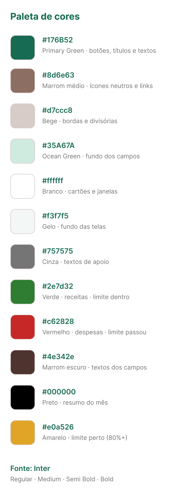 |  | 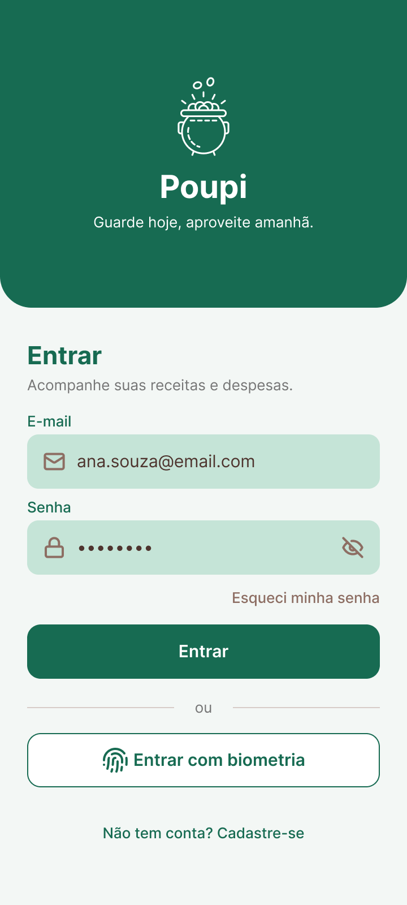 |  |

| Criar conta | Esqueci senha | Grupos | Menu de opções |
|---|---|---|---|
| 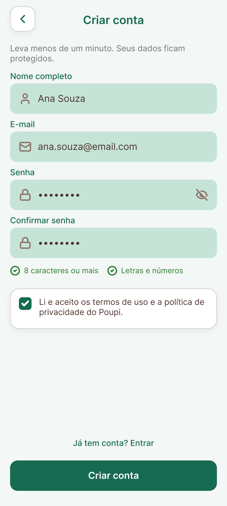 | 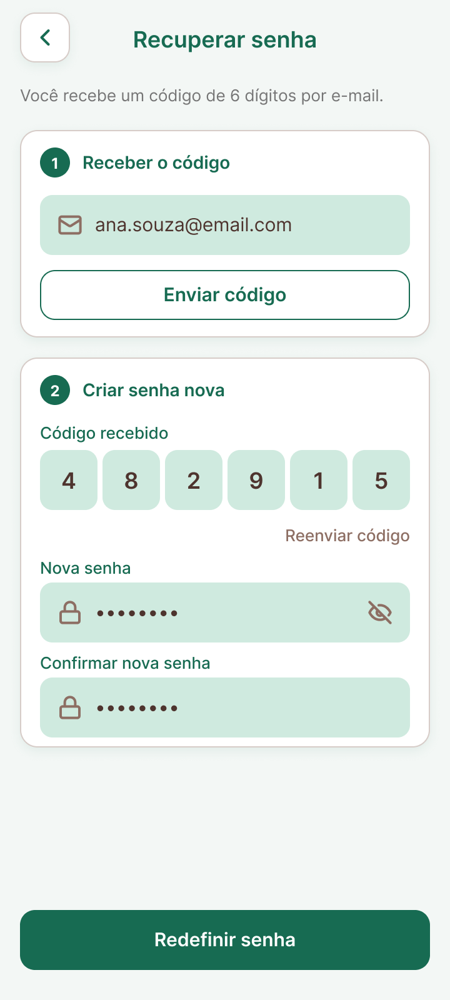 | 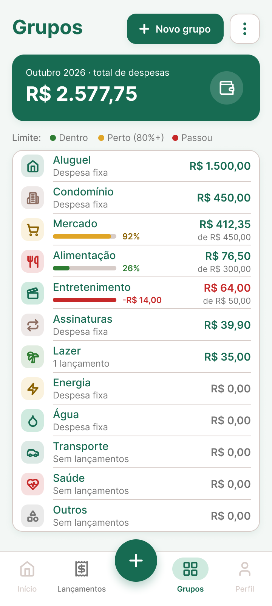 | 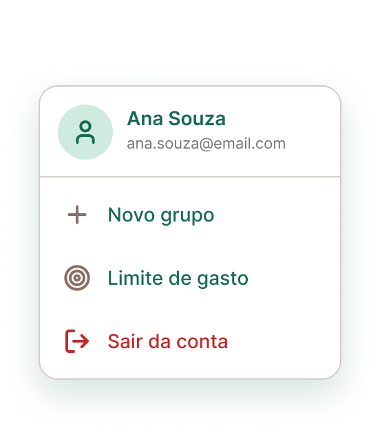 |

| Detalhe do grupo | Limite do grupo | Novo grupo | Lançamentos |
|---|---|---|---|
| 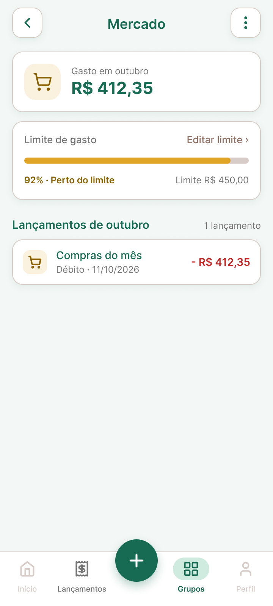 | 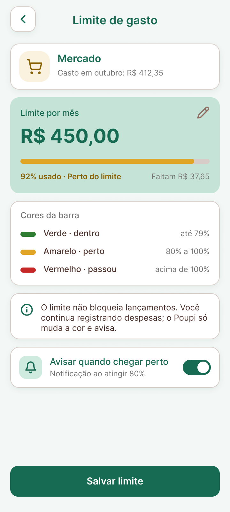 |  | 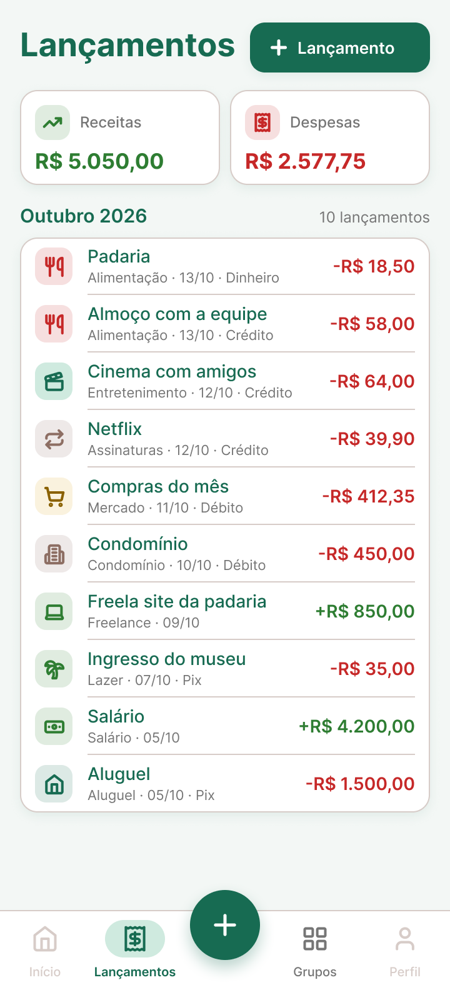 |

| Novo lançamento | Nova receita | Nova despesa | Selecionar grupo |
|---|---|---|---|
| 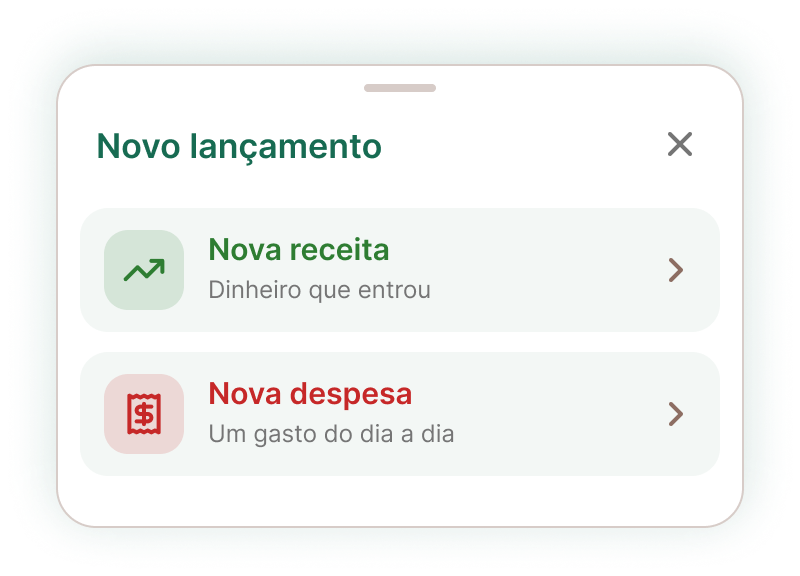 | 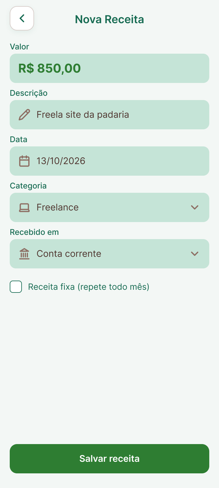 |  | 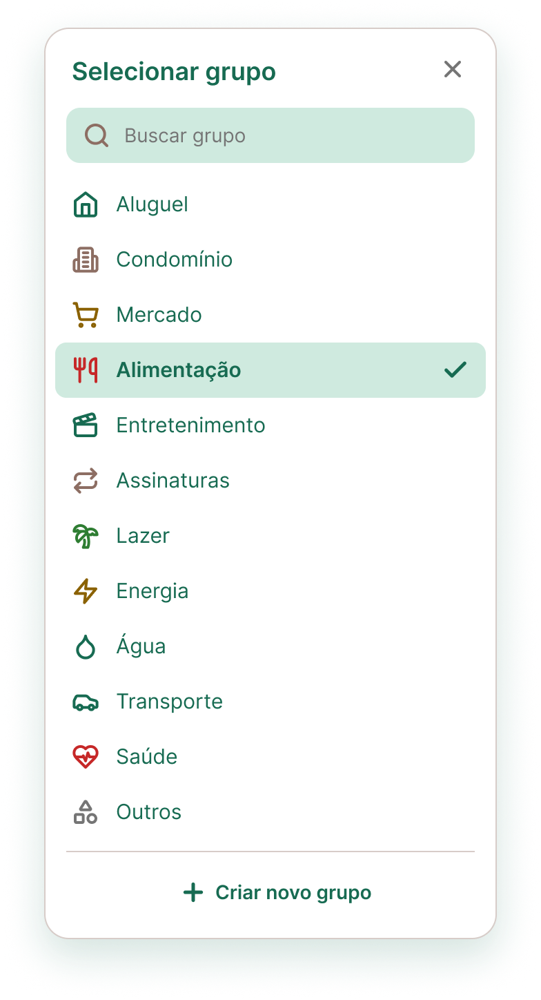 |

| Nova despesa (acima do limite) |
|---|
|  |

### Fluxo do protótipo (começa em Carregamento, 59 interações)

| De | Ação | Para |
|---|---|---|
| Carregamento | depois de 1,5 s | Login |
| Login · Entrar | clique | Grupos |
| Login · Entrar com biometria | clique | abre Biometria por cima; o sensor leva a Grupos |
| Login · Cadastre-se / Esqueci minha senha | clique | Criar conta / Esqueci senha |
| Grupos · item Mercado | clique | Detalhe do grupo → Editar limite → Limite do grupo → Salvar |
| Grupos · + Novo grupo | clique | Novo grupo → Criar grupo → Grupos |
| Botão ⋮ (Grupos e Detalhe do grupo) | clique | abre o Menu de opções: Novo grupo, Limite de gasto, Sair da conta |
| Barra de abas | clique | Lançamentos ⇄ Grupos (Início e Perfil ficam para a Sprint 3) |
| Botão + e “+ Lançamento” | clique | abre Novo lançamento: Nova receita / Nova despesa |
| Nova despesa · campo Grupo | clique | abre Selecionar grupo; Entretenimento leva à despesa acima do limite |
| Salvar receita / Salvar despesa | clique | Lançamentos |
| Salvar (acima do limite) | clique | Grupos |
| Setas de voltar | clique | tela anterior |

As janelas que abrem por cima usam fundo escurecido e fecham ao clicar fora.

---

## Sprint 1

Catálogo de cores (10 cores e a fonte Inter) e 6 telas: Carregamento, Login, Grupos, Nova receita, Nova despesa (360 × 800) e Selecionar grupo (janela por cima da Nova despesa).

| Paleta | Carregamento | Login | Grupos |
|---|---|---|---|
|  | 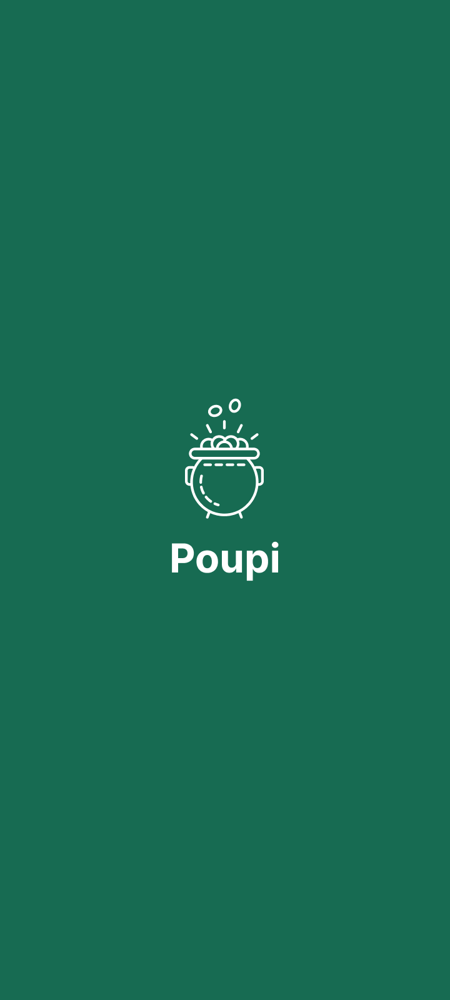 |  |  |

| Nova receita | Nova despesa | Selecionar grupo |
|---|---|---|
| 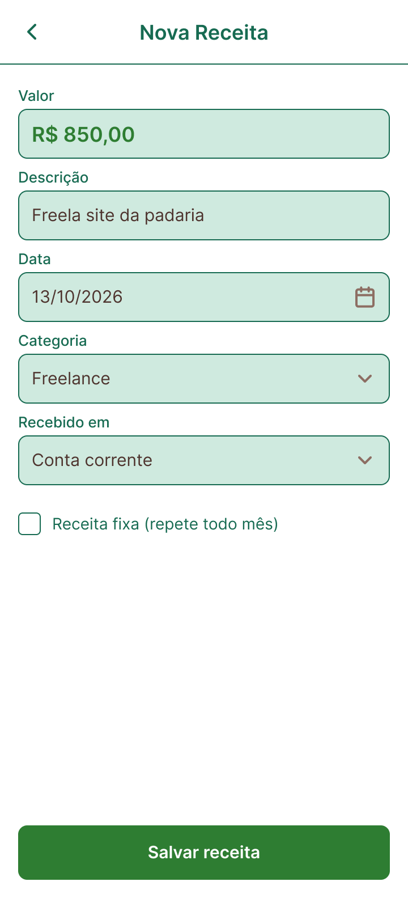 | 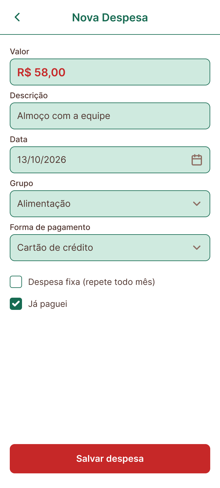 |  |

### Fluxo do protótipo (começa em Carregamento)

| De | Ação | Para |
|---|---|---|
| Carregamento | depois de 1,5 s | Login |
| Login · Entrar | clique | Grupos |
| Grupos · + Receita | clique | Nova receita |
| Grupos · + Despesa | clique | Nova despesa |
| Nova despesa · campo Grupo | clique | abre Selecionar grupo por cima (fundo escurecido, fecha ao clicar fora) |
| Selecionar grupo · um grupo ou X | clique | fecha o seletor |
| Salvar receita / Salvar despesa | clique | Grupos |
| Setas de voltar | clique | tela anterior |

"+ Novo grupo" e "Criar novo grupo" aparecem nas telas, mas só ganharam ligação na Sprint 2.
