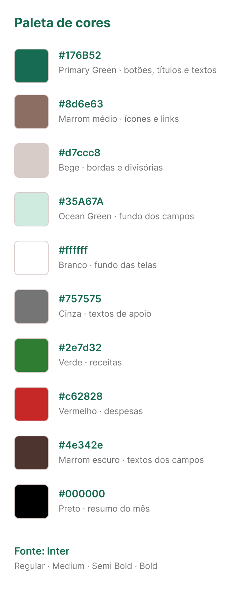
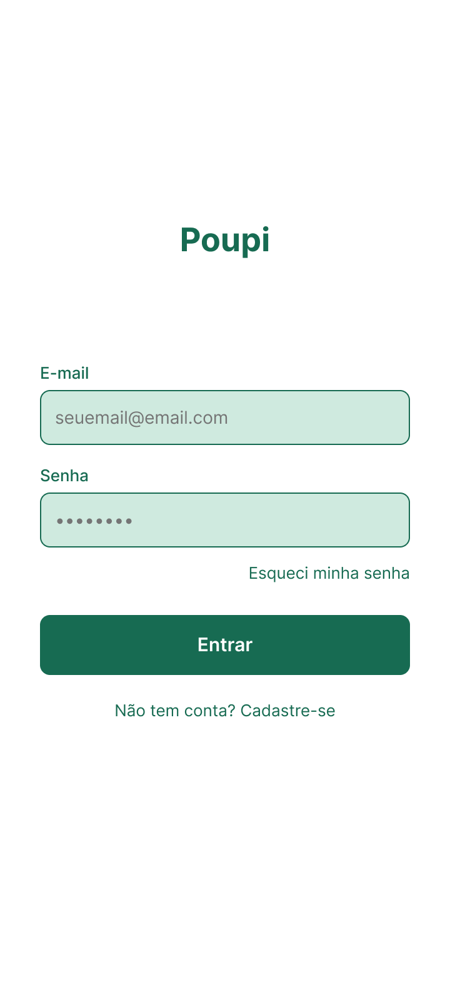
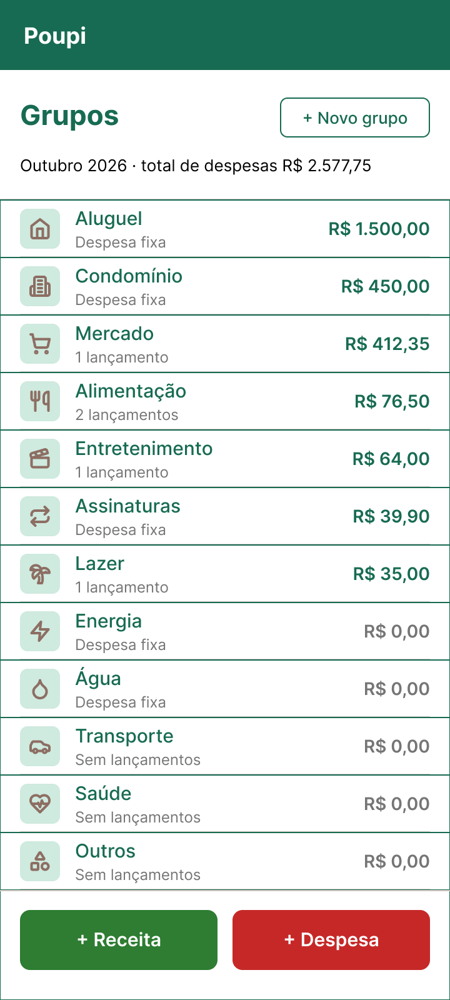
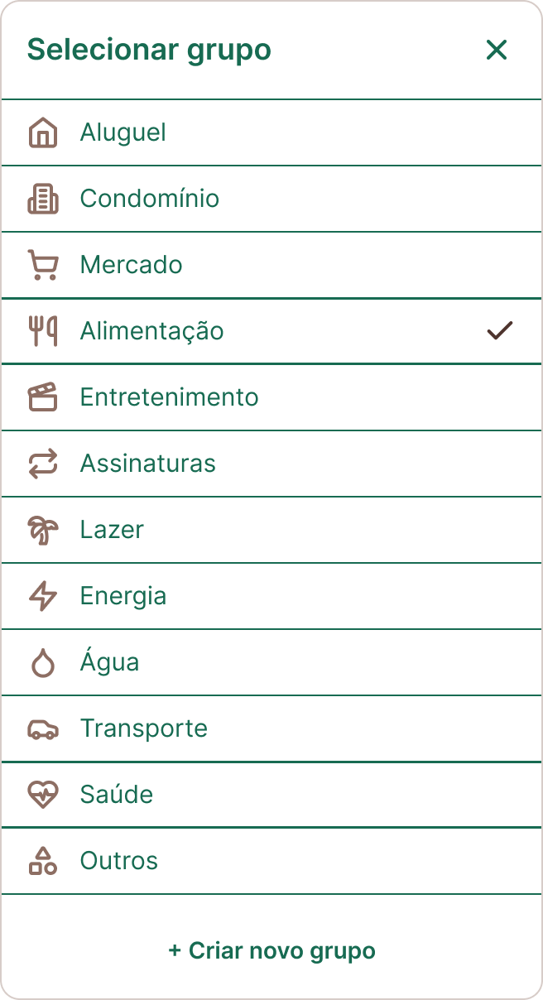

# Figma — Protótipo Sprint 1

- **Arquivo (edição):** https://www.figma.com/design/DnGzwIqbQO0d4Wb0ymdqYV/Poupi
- **Protótipo navegável:** https://www.figma.com/proto/DnGzwIqbQO0d4Wb0ymdqYV/Poupi?node-id=1-32&starting-point-node-id=1%3A32

Página **"Sprint 1 - Protótipo"**, com o catálogo de cores (10 cores e a fonte Inter) e 6 telas: `FrmSplash`, `FrmLogin`, `FrmGrupos`, `FrmNovaReceita`, `FrmNovaDespesa` (360 × 800) e `FrmSelecionarGrupo` (janela por cima da Nova Despesa).

## Telas

| Paleta | Carregamento | Login | Grupos |
|---|---|---|---|
|  |  |  |  |

| Nova receita | Nova despesa | Selecionar grupo |
|---|---|---|
|  |  |  |

## Fluxo do protótipo (começa em FrmSplash)

| De | Ação | Para |
|---|---|---|
| FrmSplash | depois de 1,5 s | FrmLogin |
| FrmLogin · Entrar | clique | FrmGrupos |
| FrmGrupos · + Receita | clique | FrmNovaReceita |
| FrmGrupos · + Despesa | clique | FrmNovaDespesa |
| FrmNovaDespesa · campo Grupo | clique | abre FrmSelecionarGrupo por cima (fundo escurecido, fecha ao clicar fora) |
| FrmSelecionarGrupo · um grupo ou X | clique | fecha o seletor |
| Salvar receita / Salvar despesa | clique | FrmGrupos |
| Setas de voltar | clique | tela anterior |

"+ Novo grupo" e "Criar novo grupo" aparecem nas telas, mas ficam sem ligação nesta sprint.

## Inconsistência mantida

Na Nova Despesa, os rótulos e os textos dos checkboxes estão em marrom `#4E342E`; na Nova Receita, estão em verde.
