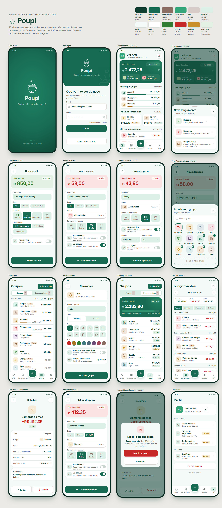

# Projeto Final — visão do app completo

Como o Poupi deve ficar ao fim das sprints: 16 telas com início e saldo do mês, cadastro de receitas e despesas, despesas fixas, grupos (prontos e criados pelo usuário), extrato, detalhe, edição, exclusão e perfil. É a referência para as Sprints 2 e 3.

- **Página navegável:** abra `poupi-projeto-final.html` no navegador (baixe o arquivo e dê dois cliques). Clicar numa tela abre o modo navegável. A página precisa de internet para carregar a fonte e os ícones.
- **Imagens:** a pasta `Telas` tem uma imagem de cada tela e a prancha geral.

