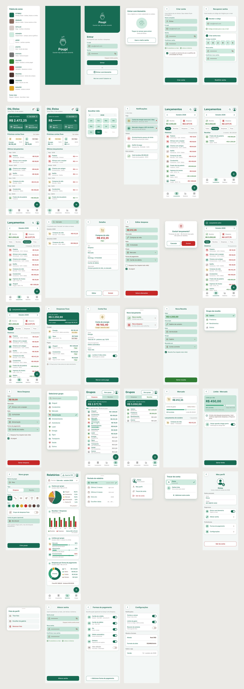

# Trabalho — Poupi (Engenharia de Software)

Protótipo de um app de **finanças pessoais** feito no Figma, entregue em sprints. O app ajuda a controlar, de forma simples, receitas e despesas, separadas em grupos (Aluguel, Mercado, Lazer, Assinaturas…), com despesas fixas, limite de gasto por grupo e relatórios com gráficos.

- **Sprint 1:** protótipo navegável com 6 telas (carregamento, login, grupos, nova receita, nova despesa e seleção de grupo) e catálogo de cores.
- **Sprint 2:** 19 telas, com login por biometria, criação de conta, recuperação de senha, limite de gasto por grupo (barra de uma cor só com a marca do limite, que avisa sem bloquear), grupos de receita com filtro, novo grupo, busca de grupo, aba de lançamentos, barra de abas e menu da foto do perfil com trocar de conta.
- **Sprint 3:** 39 telas, com a tela inicial (resumo do mês, ocultar saldo, troca de mês, próximas contas fixas e histórico), notificações, extrato com filtros e busca, detalhe, edição e exclusão de lançamentos com mensagem de confirmação, despesas fixas pagas e a pagar, a aba **Relatórios com 4 gráficos** e período, perfil, troca de foto, alteração de senha, formas de pagamento e configurações.

## Conteúdo

| Pasta | O que tem |
|---|---|
| [`Figma`](Figma) | Links do arquivo e dos protótipos, fluxos de navegação e prints de cada tela das Sprints 1, 2 e 3 |
| [`Identidade_Visual`](Identidade_Visual) | Logo do Poupi (pote com moedas), paleta de cores, fonte e medidas |
| [`Documentacao`](Documentacao) | Documentação oficial (resumo de todas as sprints) e a documentação detalhada de cada sprint, em PDF |

## Links

- **Arquivo no Figma:** https://www.figma.com/design/DnGzwIqbQO0d4Wb0ymdqYV/Poupi
- **Protótipo da Sprint 3:** https://www.figma.com/proto/DnGzwIqbQO0d4Wb0ymdqYV/Poupi?node-id=186-52&starting-point-node-id=186%3A52
- **Protótipo da Sprint 2:** https://www.figma.com/proto/DnGzwIqbQO0d4Wb0ymdqYV/Poupi?node-id=174-45&starting-point-node-id=174%3A45
- **Protótipo da Sprint 1:** https://www.figma.com/proto/DnGzwIqbQO0d4Wb0ymdqYV/Poupi?node-id=1-32&starting-point-node-id=1%3A32

## Cronograma

| Sprint | Entregável | Situação |
|---|---|---|
| 01 | Protótipo no Figma (v1) + Modelo de Dados (v1) | entregue (6 telas) |
| 02 | Ajustes da entrega 1 · Protótipo (v2) + Modelo de Dados (v2) | entregue (19 telas) |
| 03 | Protótipo (v3) + Modelo de Dados (v3) + pitch de até 10 minutos | entregue (39 telas) |
