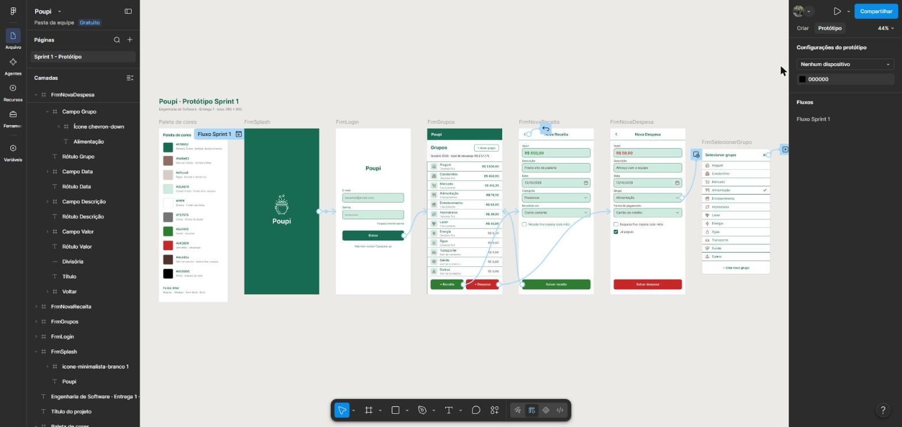

# Trabalho — Poupi (Engenharia de Software)

Protótipo de um app de **finanças pessoais** feito no Figma, entregue em sprints. O app ajuda a controlar, de forma simples, receitas e despesas, separadas em grupos (Aluguel, Mercado, Lazer, Assinaturas…), com opção de despesa fixa.

**Sprint 1:** protótipo navegável com 6 telas (carregamento, login, grupos, nova receita, nova despesa e seleção de grupo) e catálogo de cores.

## Conteúdo

| Pasta | O que tem |
|---|---|
| [`Figma`](Figma) | Link do arquivo e do protótipo, fluxo de navegação e prints de cada tela da Sprint 1 |
| [`Projeto_Final`](Projeto_Final) | Visão do app completo esperado (16 telas): página HTML navegável e imagens das telas |
| [`Identidade_Visual`](Identidade_Visual) | Logo do Poupi (pote com moedas), paleta de cores, fonte e medidas |
| [`Documentacao`](Documentacao) | `Sprint_1.pdf`: guia de estudo de como o protótipo foi pensado e montado no Figma |

## Links

- **Arquivo no Figma:** https://www.figma.com/design/DnGzwIqbQO0d4Wb0ymdqYV/Poupi
- **Protótipo navegável:** https://www.figma.com/proto/DnGzwIqbQO0d4Wb0ymdqYV/Poupi?node-id=1-32&starting-point-node-id=1%3A32

## Cronograma

| Sprint | Entregável |
|---|---|
| 01 | Protótipo no Figma (v1) + Modelo de Dados (v1) |
| 02 | Ajustes da entrega 1 · Protótipo (v2) + Modelo de Dados (v2) |
| 03 | Protótipo (v3) + Modelo de Dados (v3) + pitch de até 10 minutos |
